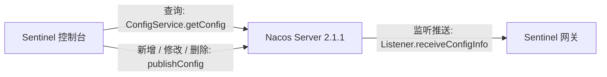

# Sentinel 控制台

## 0. 概述

Sentinel 控制台是流量控制、熔断降级规则统一配置和管理的入口，它为用户提供了机器自发现、簇点链路自发现、监控、规则配置等功能。在 Sentinel 控制台上，我们可以配置规则并实时查看流量控制效果。

本模块在 Sentinel 1.8.7 上对接 **Nacos Server 2.1.1**：控制台改规则会整份写回 Nacos，打开页面时再从 Nacos 拉回。网关订阅同一份配置，不再接收控制台的 HTTP 推送。改动和同步方式见下文第 4 节起。

## 1. 编译和启动

### 1.1 如何编译

使用如下命令将代码打包成一个 fat jar:

```bash
mvn clean package
```

打包产物名为 `sentinel-dashboard-1.8.7-customized.jar`。

### 1.2 如何启动

使用如下命令启动编译后的控制台：

```bash
java -Dserver.port=8080 \
-Dcsp.sentinel.dashboard.server=localhost:8080 \
-Dproject.name=sentinel-dashboard \
-jar target/sentinel-dashboard-1.8.7-customized.jar
```

上述命令中我们指定几个 JVM 参数，其中 `-Dserver.port=8080` 是 Spring Boot 的参数，
用于指定 Spring Boot 服务端启动端口为 `8080`。其余几个是 Sentinel 客户端的参数。

为便于演示，我们对控制台本身加入了流量控制功能，具体做法是引入 Sentinel 提供的 `CommonFilter` 这个 Servlet Filter。
上述 JVM 参数的含义是：

| 参数 | 作用 |
|--------|--------|
|`-Dcsp.sentinel.dashboard.server=localhost:8080`|向 Sentinel 接入端指定控制台的地址|
|`-Dproject.name=sentinel-dashboard`|向 Sentinel 指定应用名称，比如上面对应的应用名称就为 `sentinel-dashboard`|

全部的配置项可以参考 [启动配置项文档](https://github.com/alibaba/Sentinel/wiki/%E5%90%AF%E5%8A%A8%E9%85%8D%E7%BD%AE%E9%A1%B9)。

经过上述配置，控制台启动后会自动向自己发送心跳。程序启动后浏览器访问 `localhost:8080` 即可访问 Sentinel 控制台。

从 Sentinel 1.6.0 开始，Sentinel 控制台支持简单的**登录**功能，默认用户名和密码都是 `sentinel`。用户可以通过如下参数进行配置：

- `-Dsentinel.dashboard.auth.username=sentinel` 用于指定控制台的登录用户名为 `sentinel`；
- `-Dsentinel.dashboard.auth.password=123456` 用于指定控制台的登录密码为 `123456`；如果省略这两个参数，默认用户和密码均为 `sentinel`；
- `-Dserver.servlet.session.timeout=7200` 用于指定 Spring Boot 服务端 session 的过期时间，如 `7200` 表示 7200 秒；`60m` 表示 60 分钟，默认为 30 分钟；

Nacos 地址、命名空间和鉴权账号写在 `application.properties` 的 `nacos.*` 中。Docker 部署时用同名环境变量覆盖，环境变量优先，说明见第 4.2 节。

## 2. 客户端接入

选择合适的方式接入 Sentinel，然后在应用启动时加入 JVM 参数 `-Dcsp.sentinel.dashboard.server=consoleIp:port` 指定控制台地址和端口。
确保客户端有访问量，**Sentinel 会在客户端首次调用的时候进行初始化，开始向控制台发送心跳包**，将客户端纳入到控制台的管辖之下。

客户端接入的详细步骤请参考 [Wiki 文档](https://github.com/alibaba/Sentinel/wiki/%E6%8E%A7%E5%88%B6%E5%8F%B0#3-%E5%AE%A2%E6%88%B7%E7%AB%AF%E6%8E%A5%E5%85%A5%E6%8E%A7%E5%88%B6%E5%8F%B0)。

网关限流和熔断要生效，除心跳外还要按第 5 节的 Data ID 订阅 Nacos，见第 6.3 节。

## 3. 验证是否接入成功

客户端正确配置并启动后，会**在初次调用后**主动向控制台发送心跳包，汇报自己的存在；
控制台收到客户端心跳包之后，会在左侧导航栏中显示该客户端信息。如果控制台能够看到客户端的机器信息，则表明客户端接入成功了。

## 4. 兼容 Nacos 2.1.1 的代码改动

官方 1.8.7 控制台把规则放在内存里，通过 `SentinelApiClient` 用 HTTP 推到每台机器。控制台重启后规则丢失，在 Nacos 里改配置也不会回到控制台。官方 Nacos 示例只放在 `src/test`，并且 `sentinel-datasource-nacos` 依赖的是 `nacos-client` **1.4.2**。Nacos 2.1.1 的配置通道是 gRPC，1.4.2 客户端不能作为 2.1.1 的配置客户端使用。

### 4.1 用 2.x 客户端覆盖 1.4.2

`sentinel-dashboard/pom.xml` 直接声明：

```xml
<dependency>
    <groupId>com.alibaba.nacos</groupId>
    <artifactId>nacos-client</artifactId>
    <version>2.2.0</version>
</dependency>
```

`sentinel-datasource-nacos` 仍传递依赖 `nacos-client` 1.4.2。Maven 就近原则下，控制台的直接依赖会选中 **2.2.0**。2.2.0 客户端走 gRPC，可以连接 Nacos Server 2.1.1。

部署时除 HTTP 端口（默认 `8848`）外，还要放通 gRPC 端口。默认是主端口加 1000，即 `9848`。只开放 `8848` 时，2.x 客户端无法完成配置的发布和订阅。

同一份 `pom.xml` 里，`sentinel-datasource-nacos` 从 `test` 范围改为参与打包，供运行时使用 `Converter` 等类型。

### 4.2 按 Nacos 2.x 的鉴权方式创建 ConfigService

运行时的客户端在 `NacosConfig.nacosConfigService()` 中创建。`application.properties` 用 Spring 占位符读取环境变量，未设置时用冒号后的默认值。容器里导出的环境变量优先于文件中的默认值：

| 配置项 | 环境变量（优先） | 注入字段 | 含义 |
| --- | --- | --- | --- |
| `nacos.address` | `NACOS_ADDRESS` | `PropertyKeyConst.SERVER_ADDR` | Nacos 地址，例如 `host:8848` |
| `nacos.namespace` | `NACOS_NAMESPACE` | `PropertyKeyConst.NAMESPACE` | 命名空间 ID |
| `nacos.username` | `NACOS_USERNAME` | `PropertyKeyConst.USERNAME` | 鉴权用户名 |
| `nacos.password` | `NACOS_PASSWORD` | `PropertyKeyConst.PASSWORD` | 鉴权密码 |
| `nacos.groupId` | `NACOS_GROUP_ID` | 读写时传入的 Group | 配置分组，默认 `DEFAULT_GROUP_YML` |

`pom.xml` 把资源过滤分隔符设成了 `@`，因此 `${NACOS_ADDRESS:...}` 不会在打包时被 Maven 吃掉，而是在进程启动时由 Spring 解析。`namespace` 填的是命名空间 ID。Nacos 2.1.1 开启鉴权后，不带用户名和密码无法发布、读取配置。地址、命名空间、用户名、密码的环境变量设成空字符串时，Spring 会采用这个空值，不会再回退到默认值。`NACOS_GROUP_ID` 为空白时仍使用 `DEFAULT_GROUP_YML`。

Group 不放进 `ConfigService` 的连接参数。`publishConfig` / `getConfig` 每次调用都要单独传 Group，原先写死在 `NacosConfigUtil.GROUP_ID`。启动时 `NacosConfig` 把 `nacos.groupId` 写回这个字段，各 Publisher / Provider 不用改调用点。该字段不能是 `static final`，否则编译器会把字面量内联进调用方，运行时改配置不会生效。

`NacosPropertiesConfiguration`（前缀 `sentinel.nacos`）以及 `application.properties` 里被注释的 `sentinel.nacos.*` 不参与创建 `ConfigService`。

官方测试示例 `src/test/.../rule/nacos/NacosConfig.java` 仍使用 `ConfigFactory.createConfigService("localhost")`。那个类只在测试时加载，改它不会影响控制台运行。

### 4.3 发布时标明 JSON 类型

1.4.x 示例调用的是三参数 `publishConfig(dataId, group, content)`。本模块的 Publisher 改为四参数，并传入配置类型：

```java
configService.publishConfig(dataId, NacosConfigUtil.GROUP_ID,
        converter.convert(rules), ConfigType.JSON.getType());
```

`ConfigType` 来自 `nacos-client` 2.x。这样 Nacos 2.1.1 会把该配置记为 JSON，控制台里可以直接按 JSON 查看和编辑。

读写超时与官方数据源一致，`getConfig` 的超时为 3000 毫秒。配置内容为空时，Provider 返回空列表。

### 4.4 规则接口改为读写 Nacos

下列接口里，原来的 `SentinelApiClient` 拉取和推送已停用，改为注入对应的 Nacos Provider / Publisher：

| 功能 | Controller | 查询 | 发布 |
| --- | --- | --- | --- |
| 网关限流 | `GatewayFlowRuleController` | `gatewayFlowRulesNacosProvider` | `gatewayFlowRulesNacosPublisher` |
| 网关 API 分组 | `GatewayApiController` | `gatewayApiNacosProvider` | `gatewayApiNacosPublisher` |
| 熔断降级 | `DegradeController` | `degradeRuleNacosProvider` | `degradeRuleNacosPublisher` |
| 流控（v2） | `FlowControllerV2` | `flowRuleNacosProvider` | `flowRuleNacosPublisher` |
| 热点参数 | `ParamFlowRuleController` | `paramFlowRuleNacosProvider` | `paramFlowRuleNacosPublisher` |
| 系统规则 | `SystemController` | `systemRuleNacosProvider` | `systemRuleNacosPublisher` |
| 授权规则 | `AuthorityRuleController` | `authorityRuleNacosProvider` | `authorityRuleNacosPublisher` |

`FlowControllerV1` 仍通过 `SentinelApiClient` 直连机器，不经过 Nacos。

编解码在 `NacosConfig` 中用 Fastjson 完成：写入 `JSON.toJSONString`，读出 `JSON.parseArray`。

## 5. Nacos 中的配置约定

Group 来自 `nacos.groupId`，环境变量 `NACOS_GROUP_ID` 优先，默认 `DEFAULT_GROUP_YML`。名称里带有 YML，文件内容仍是 JSON。

Data ID 由应用名加后缀组成。应用名即控制台左侧的 app，也是网关侧 `spring.application.name` / `project.name`。

| 规则 | Data ID | 写入的 Java 类型 |
| --- | --- | --- |
| 网关限流 | `{app}-gw-flow-rules.json` | `List<GatewayFlowRuleEntity>` |
| 熔断降级 | `{app}-degrade-rules.json` | `List<DegradeRuleEntity>` |
| 网关 API 分组 | `{app}-gw-api-group-rules.json` | `List<ApiDefinitionEntity>` |
| 流控 v2 | `{app}-flow-rules.json` | `List<FlowRuleEntity>` |
| 热点参数 | `{app}-param-rules.json` | `List<ParamFlowRuleEntity>` |
| 系统规则 | `{app}-system-rules.json` | `List<SystemRuleEntity>` |
| 授权规则 | `{app}-authority-rules.json` | `List<AuthorityRuleEntity>` |

例如应用 `api-gateway` 的网关限流配置为：

- Namespace：`nacos.namespace`
- Group：`nacos.groupId`（默认 `DEFAULT_GROUP_YML`）
- Data ID：`api-gateway-gw-flow-rules.json`

熔断配置的 Data ID 为 `api-gateway-degrade-rules.json`，Group 与 Namespace 相同。

网关限流如果按 API 分组生效，分组定义在 `{app}-gw-api-group-rules.json`，同步方式和限流规则相同。

## 6. 双向同步如何实现

控制台侧是「写时推送、查时拉取」，没有注册 Nacos `Listener`。页面不刷新时，不会自动感知 Nacos 上的修改。

网关侧使用本仓库 `sentinel-datasource-nacos` 的 `NacosDataSource`。它在启动时 `getConfig` 拉一次，并 `addListener`。Nacos 2.1.1 上的配置变更会回调 `receiveConfigInfo`，网关随之更新内存规则。



两条方向：

1. **控制台 → Nacos → 网关**  
   在控制台新增、修改或删除规则后，Publisher 立刻 `publishConfig`。网关的 `NacosDataSource` 收到推送并生效。
2. **Nacos → 控制台，同时 Nacos → 网关**  
   在 Nacos 控制台修改同一 Data ID 后，网关由监听器实时更新。Sentinel 控制台在下次打开规则列表时 `getConfig`，用拉回的结果覆盖内存并展示。

因此「双向」指的是：控制台和 Nacos 都能成为修改入口，另一侧能读到同一份 JSON；网关只订阅 Nacos，不接受控制台直推。

### 6.1 网关限流

类：`GatewayFlowRulesNacosProvider`、`GatewayFlowRulesNacosPublisher`。  
接口前缀：`/gateway/flow`。

**Nacos → 控制台（查询）**

`GET /gateway/flow/list.json`：

1. `getConfig("{app}-gw-flow-rules.json", groupId, 3000)`，`groupId` 为 `nacos.groupId`。
2. JSON 反序列化为 `GatewayFlowRuleEntity`。
3. 补上当前页面的 `app`、`ip`、`port`。`interval` 为空时按 1 秒，`intervalUnit` 为空时按秒，`controlBehavior` 为空时按快速失败，`burst` 为空时按 0。
4. `InMemGatewayFlowRuleStore.saveAll` 用这份列表替换内存仓库，再返回页面。

**控制台 → Nacos（写入）**

| 操作 | 接口 | 行为 |
| --- | --- | --- |
| 新增 | `POST /gateway/flow/new.json` | 校验后写入内存，再发布该应用的全量规则 |
| 修改 | `POST /gateway/flow/save.json` | 按 id 改内存记录，再发布全量 |
| 删除 | `POST /gateway/flow/delete.json` | 从内存删除，再发布全量 |

发布时 `publishRules` 调用 `repository.findAllByApp(app)`，把该应用内存中的全部规则序列化后 `publishConfig`。删除最后一条时发布空数组 `[]`，Nacos 上的旧规则会被清掉。

新增时的 id：先从 Nacos 读出现有规则，取最大 id 加 1。Nacos 中还没有规则时，由内存仓库从 1 开始编号。后续修改和删除都按这个 id 在内存中定位。

写入 Nacos 的是 `GatewayFlowRuleEntity` 的 JSON，包含 `id`、`app`、`ip`、`port`、`gmtCreate`、`gmtModified`，以及规则字段。统计窗口在 JSON 里是 `interval` 加上 `intervalUnit`（0 秒、1 分、2 时、3 天）。网关运行时的 `GatewayFlowRule` 使用的是 `intervalSec`（秒）。网关解析这份 JSON 时要做同样的换算，逻辑与 `GatewayFlowRuleEntity.calIntervalSec` 一致：

| intervalUnit | intervalSec |
| --- | --- |
| 0 | `interval` |
| 1 | `interval * 60` |
| 2 | `interval * 60 * 60` |
| 3 | `interval * 60 * 60 * 24` |

直接把 JSON 反序列化成 `GatewayFlowRule` 时，`intervalSec` 对不上，限流窗口会偏离控制台上配置的值。

### 6.2 熔断

类：`DegradeRuleNacosProvider`、`DegradeRuleNacosPublisher`。  
接口前缀：`/degrade`。熔断规则按应用存放，网关和应用共用 `{app}-degrade-rules.json`。

**Nacos → 控制台（查询）**

`GET /degrade/rules.json` 按应用 `getConfig`，反序列化为 `DegradeRuleEntity` 后 `saveAll` 进 `InMemDegradeRuleStore`。查询前会校验 `ip` 属于该应用。

**控制台 → Nacos（写入）**

| 操作 | 接口 |
| --- | --- |
| 新增 | `POST /degrade/rule` |
| 修改 | `PUT /degrade/rule/{id}` |
| 删除 | `DELETE /degrade/rule/{id}` |

三次写操作都是先改内存，再把 `findAllByApp(app)` 的结果整份发布到 `{app}-degrade-rules.json`。

JSON 里除熔断字段外，还有 `id`、`app`、`ip`、`port`、`gmtCreate`、`gmtModified`。熔断字段与 `DegradeRule` 一致：`resource`、`limitApp`、`count`、`timeWindow`、`grade`、`minRequestAmount`、`slowRatioThreshold`、`statIntervalMs`。网关用 Fastjson 解析成 `DegradeRule` 时，多出来的控制台字段会被忽略，规则字段可以直接加载。`DegradeRuleEntity.toRule()` 负责生成运行时规则，Publisher 本身发布的仍是实体 JSON。

`grade` 的取值范围与 Sentinel 熔断策略一致：慢调用比例、异常比例、异常数。

### 6.3 网关侧订阅

本模块不包含网关工程。网关要跟上同一份配置，需要同时满足：

- `nacos.address`、`nacos.namespace`、用户名、密码与控制台一致；
- Group 与控制台的 `nacos.groupId` 一致，默认 `DEFAULT_GROUP_YML`；
- 网关限流 Data ID 为 `{app}-gw-flow-rules.json`，熔断 Data ID 为 `{app}-degrade-rules.json`；
- 使用 `NacosDataSource`（`sentinel-extension/sentinel-datasource-nacos`）注册数据源，在监听回调里把 JSON 转成 `GatewayFlowRule` / `DegradeRule` 并交给对应的 `RuleManager`。

`NacosDataSource` 在构造时会 `addListener`。控制台 `publishConfig` 或在 Nacos 页面保存后，网关都会收到新内容。网关客户端同样需要 2.x（与 Server 2.1.1 匹配），并放通 gRPC 端口。

## 7. 使用时要注意的行为

内存仓库只是页面会话中的副本，Nacos 才是跨重启的存储。

- 打开列表时，`saveAll` 会先清空整个内存仓库，再放入本次从 Nacos 读到的规则。
- 新增、修改、删除发布的是**当时内存里该应用的全量列表**，会覆盖 Nacos 上的同名 Data ID。
- 在内存还没有和 Nacos 对齐时直接新增或删除，发布出去的可能只是内存中的子集，Nacos 里已有的其他规则会被覆盖。操作前应先打开对应规则页，让查询把 Nacos 内容装入内存。
- 控制台没有长连接监听。在 Nacos 里改完配置后，需要重新打开或刷新规则页，控制台才会显示新内容。网关则依赖 `NacosDataSource` 的监听，不必刷新控制台。
- `FlowControllerV1`（`/v1/flow`）仍直连机器，不在本次 Nacos 同步范围内。网关限流走 `/gateway/flow`，熔断走 `/degrade`。

## 8. 构建 Docker 镜像

```
docker build --build-arg SENTINEL_VERSION=1.8.7 -t ${REGISTRY}/sentinel-dashboard:v1.8.7 .
```

使用本模块打包的 jar 启动时，用环境变量覆盖 Nacos 连接，未传入的项仍用 `application.properties` 中的默认值：

```bash
docker run -d --name sentinel-dashboard \
  -p 8080:8080 \
  -e NACOS_ADDRESS=nacos-host:8848 \
  -e NACOS_NAMESPACE=namespace-id \
  -e NACOS_USERNAME=nacos \
  -e NACOS_PASSWORD=nacos \
  -e NACOS_GROUP_ID=DEFAULT_GROUP_YML \
  ${REGISTRY}/sentinel-dashboard:v1.8.7
```

*注意：Sentinel 控制台目前仅支持单机部署。Sentinel 控制台项目提供 Sentinel 功能全集示例，不作为开箱即用的生产环境控制台，不提供安全可靠保障。若希望在生产环境使用请根据[文档](https://github.com/alibaba/Sentinel/wiki/%E5%9C%A8%E7%94%9F%E4%BA%A7%E7%8E%AF%E5%A2%83%E4%B8%AD%E4%BD%BF%E7%94%A8-Sentinel)自行进行定制和改造。*

更多：[控制台功能介绍](./Sentinel_Dashboard_Feature.md)。
